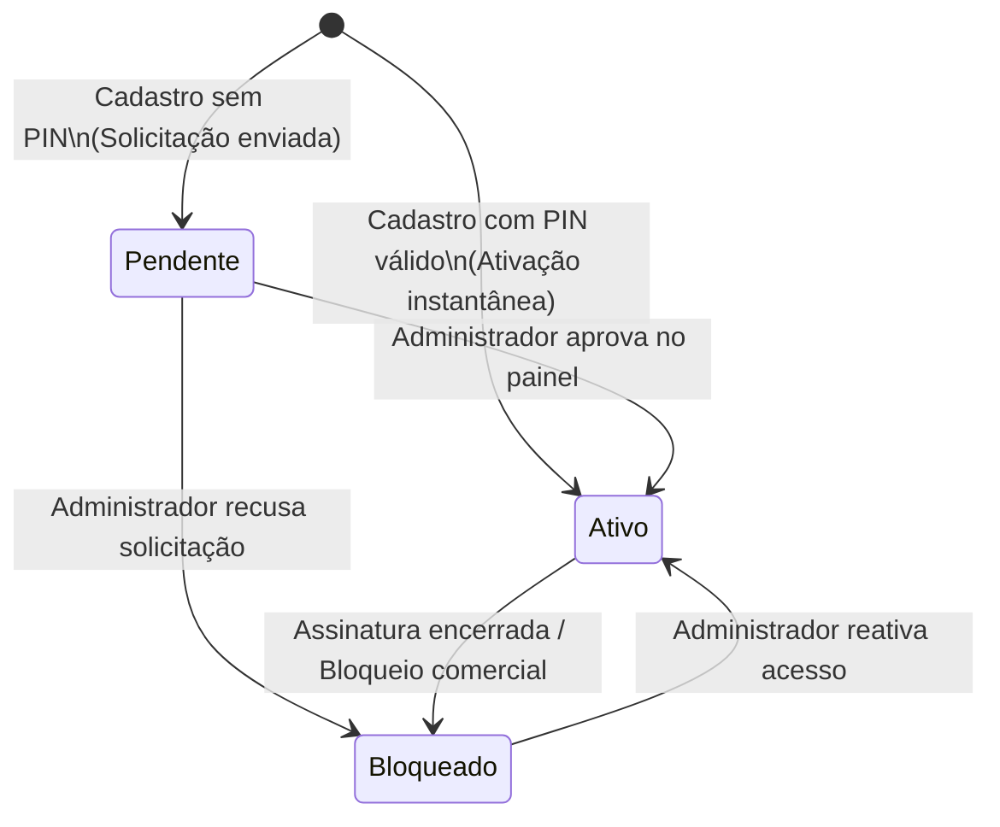

# Data Model: Restrição, PIN de Acesso e Aprovação de Professores

**Feature**: `010-permissao-cadastro-professor`  
**Date**: 2026-11-01  
**Status**: Completed  

---

## 1. Entidades do Firestore

### 1.1 Coleção `professors` (Atualização)

Representa tanto as contas ativas de professores/avaliadores quanto as solicitações pendentes de aprovação pelo administrador.

- **ID do Documento**: SHA-256 do `emailLower` ou ID gerado pelo Firestore.
- **Campos**:
  - `name` *(string, obrigatório)*: Nome completo do professor (mínimo 3 caracteres).
  - `emailLower` *(string, obrigatório)*: E-mail em letras minúsculas (único logicamente).
  - `phone` *(string, obrigatório)*: Número de WhatsApp/telefone com DDD (ex.: `"11999998888"` ou `"(11) 99999-8888"`).
  - `passwordHash` *(string, obrigatório)*: Hash SHA-256 de 64 caracteres hexadecimais da senha.
  - `status` *(string, obrigatório)*:
    - `'pendente'`: Solicitação enviada pelo site, aguardando aprovação do administrador.
    - `'ativo'`: Conta liberada e autorizada a avaliar alunos e usar o RunLab.
    - `'bloqueado'`: Acesso temporariamente ou permanentemente suspenso.
  - `role` *(string, obrigatório)*:
    - `'admin'`: Proprietário/administrador da plataforma com poderes para aprovar novas contas e gerar PINs.
    - `'professor'`: Usuário padrão do sistema de avaliação.
  - `activationPin` *(string, opcional)*: Código ou PIN de ativação utilizado no momento do cadastro (se aplicável).
  - `createdAt` *(string ISO 8601)*: Momento em que a solicitação ou cadastro foi efetuado.
  - `approvedAt` *(string ISO 8601, opcional)*: Momento em que o administrador aprovou o acesso.
  - `approvedBy` *(string, opcional)*: E-mail do administrador responsável pela aprovação.

#### Regras de Validação:
- `name`: String não-vazia, >= 3 caracteres.
- `emailLower`: Formato de e-mail válido contendo `@` e `.`.
- `phone`: String com pelo menos 8 dígitos numéricos.
- `passwordHash`: String hexadecimal de exatamente 64 caracteres.
- `status`: Um entre `['pendente', 'ativo', 'bloqueado']`.
- `role`: Um entre `['admin', 'professor']`.

---

### 1.2 Coleção `activation_codes` (Nova)

Representa os códigos alfanuméricos ou PINs de licença gerados pelo administrador comercial para entrega avulsa a clientes ou venda de acessos.

- **ID do Documento**: Código de ativação normalizado em caixa alta (ex.: `"RL-741928"` ou `"PIN-902184"`).
- **Campos**:
  - `code` *(string, obrigatório)*: O código ou PIN de ativação (ex.: `"RL-741928"`).
  - `status` *(string, obrigatório)*:
    - `'disponivel'`: Código gerado pelo administrador, pronto para ser usado por um cliente.
    - `'utilizado'`: Código já resgatado e vinculado a uma conta de professor.
    - `'cancelado'`: Código revogado pelo administrador antes do uso.
  - `createdAt` *(string ISO 8601)*: Data e hora de criação do código.
  - `createdBy` *(string, obrigatório)*: E-mail do administrador que gerou o código.
  - `usedByEmail` *(string, opcional)*: E-mail do professor que utilizou o código para ativação instantânea.
  - `usedAt` *(string ISO 8601, opcional)*: Data e hora em que o código foi resgatado.

---

### 1.3 Entidade em Memória / Sessão Local (`AuthSessionManager`)

Representa a sessão persistida no navegador do professor:
- Chave `localStorage`: `runlab_auth_session`
- Estrutura:
  ```json
  {
    "type": "professor",
    "user": {
      "id": "docId_professors",
      "name": "Prof. Carlos Silva",
      "email": "carlos@exemplo.com",
      "phone": "11987654321",
      "role": "professor",
      "status": "ativo"
    },
    "timestamp": 1798800000000
  }
  ```

---

## 2. Diagrama de Transição de Estados da Conta de Professor



